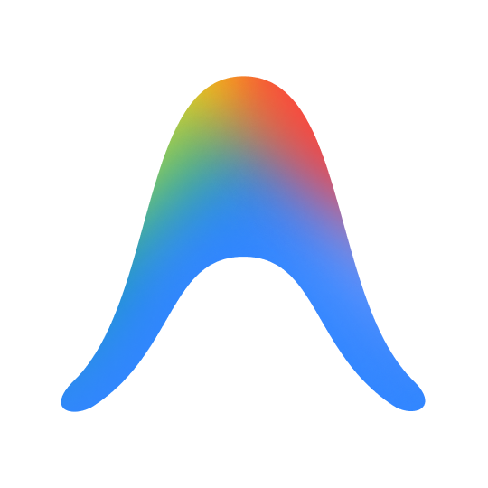

<p align="center">
  
</p>

<h1 align="center">Antigravity Powerhouse Agent Setup</h1>

<p align="center">
  <strong>The Ultimate Autonomous Full-Stack Architecture, Tactile UI, and Zero-Hallucination Operating Engine for Coding Agents.</strong>
</p>

<p align="center">
  
  
  
  
  
</p>

<p align="center">
  <em>Created & Curated by <strong>MOHAMED SAMEEN S</strong></em>
</p>

---

## 🌟 Overview

**Antigravity Powerhouse** transforms standard coding agents into **Staff-Level AI Engineers, Technical Solutions Architects, and Award-Winning Product Designers**. 

Instead of generating bloated boilerplate, broken abstractions, or generic AI templates, your agent operates under strict **cognitive disciplines, living specification contracts, micro-CSS precision, and exploit-proven security verification**.

### ⚡ Cross-Agent Compatibility (Universal)
This setup runs seamlessly across all modern agent environments:
- **Google Antigravity IDE** (`~/.gemini/config/GEMINI.md`)
- **Claude Code** (`CLAUDE.md`)
- **Cursor** (`.cursor/rules/powerhouse.mdc`)
- **OpenAI Codex / Hermes / Trae** (`AGENTS.md`)

---

## 🧠 The 6 Core Engineering Pillars

```
┌─────────────────────────────────────────────────────────────────────────────┐
│ 1. THE LIVING SPECIFICATION CONTRACT (.spec/)                               │
│    Enforces 8 project-isolated living docs (1_PRD to 8_DECISION_LEDGER).     │
│    Zero hallucinations across long sessions; changes are auto-ledgered.     │
├─────────────────────────────────────────────────────────────────────────────┤
│ 2. SURGICAL MINIMAL-DIFF INVARIANTS                                         │
│    The shortest working diff wins. Reuses platform & standard library       │
│    primitives. Zero premature abstractions or single-use wrappers.          │
├─────────────────────────────────────────────────────────────────────────────┤
│ 3. AUTONOMOUS TDD & ROOT-CAUSE VERIFICATION                                 │
│    Iron Law: No fixes without root-cause proof. Red-green-refactor loops.   │
│    Verification before declaring completion.                                │
├─────────────────────────────────────────────────────────────────────────────┤
│ 4. AWARD-WINNING TACTILE CRAFT & MICRO-CSS                                  │
│    Bans all 20 AI slop indicators. Enforces 4px grid, tabs jitter fix,      │
│    optical centering, OKLCH gradients, 100dvh, and spring physics.         │
├─────────────────────────────────────────────────────────────────────────────┤
│ 5. SEARCH & ANSWER ENGINE SUPREMACY (SEO / GEO / AEO)                       │
│    Auto-enforces Semantic HTML5, Schema.org JSON-LD graphs, and passage     │
│    structures so Google AI Overviews and Perplexity cite your work.         │
├─────────────────────────────────────────────────────────────────────────────┤
│ 6. HANDS & EYES MCP ECOSYSTEM                                               │
│    Automated Git pushes, PR creation, and Playwright headless visual tests. │
└─────────────────────────────────────────────────────────────────────────────┘
```

---

## 📦 What's Inside (46 Production Skills & Enforcement Engine)

| Category | Skills Included | Capability Highlights |
|---|---|---|
| **Architecture & Lifecycle** | `scaffold-spec`, `to-spec`, `to-tickets`, `domain-modeling`, `codebase-design`, `deprecation-and-migration` | Slices complex features into 15-min verifiable task graphs; auto-scaffolds `.spec/`; zero-downtime Expand/Contract schema migrations. |
| **Tactile UI & Motion** | `ui-ux-pro-max`, `taste-skill`, `impeccable`, `charles-polish`, `charles-ux-animation`, `animate`, `emil-design-eng`, `choreograph` | 192 product palettes, 74 font pairings, custom cubic-bezier curves, zero layout shift, Emil Kowalski spring physics. |
| **Code & Quality Discipline** | `ponytail-review`, `ponytail-audit`, `constraint-driven-development`, `source-driven-development`, `test-driven-development`, `systematic-debugging` | Senior dev code review: shortest working diff, stops agents from adding `@ts-ignore`, cites official documentation, red-green TDD loops. |
| **Backend & Commerce** | `stripe-integration`, `file-storage`, `resend-email`, `drizzle-orm-expert`, `zod-validation-expert`, `api-rate-limit-handler` | Stripe Checkout/Webhooks, Cloudflare R2 presigned uploads ($0 egress), React Email + Resend, Drizzle ORM transactions, runtime Zod validation, rate limiting. |
| **AppSec & Pentesting** | `find-security-vulnerabilities-in-code`, `owasp-top-10-testing`, `api-security-testing` | Exploit-proven security review (OWASP Top 10:2025) with working Proof-of-Concepts. |
| **Search & Citability** | `seo-geo`, `seo-schema`, `seo-technical`, `seo-content`, `seo-local`, `seo-programmatic`, `seo-audit`, `seo` | Dominates Google Search, Google AI Overviews, Perplexity, and ChatGPT citations. |
| **Enterprise Deliverables** | `mcp-builder`, `docx`, `pdf`, `xlsx`, `canvas-design`, `web-artifacts-builder` | Builds custom MCP servers and exports validated Office & interactive canvas widgets. |
| **Mechanical Enforcement** | `craft-check` (Python CLI) | Zero-dependency global CLI gate. Enforces 4px grid, `100dvh`, motion curves, kills AI slop, and audits multi-file refactors. |

---

## ⚡ Universal Agent 1-Prompt Setup (For Any Coding Agent)

Copy and paste this single prompt directly into **Claude Code, Cursor, Codex, OpenCode, Trae, or Antigravity**:

```markdown
Run this PowerShell command in your terminal right now to clone my powerhouse setup, install all missing system prerequisites (Node.js LTS, Python 3.12, uv, Git, GitHub CLI, Playwright Chromium), deploy all 46 production skills, and configure global operating invariants:

powershell -NoProfile -ExecutionPolicy Bypass -Command "if (-not (Test-Path '$HOME\antigravity-setup')) { git clone https://github.com/NullErrOR-404/antigravity-powerhouse-setup.git '$HOME\antigravity-setup' }; Set-Location '$HOME\antigravity-setup'; .\install.ps1"

Once installed, inspect `~/.gemini/config/GEMINI.md` and adopt these permanent operating rules:
1. Always enforce Ponytail (the shortest working diff wins, zero premature abstractions).
2. Always reply using Caveman protocol (conclusion and code diff first, zero filler or pleasantries).
3. Ground every client build in the 8-document `.spec/` matrix and run `craft-check` before declaring any task complete.
```

---

## 🚀 1-Click Installation (Manual Terminal)

Open **PowerShell as Administrator** on your Windows PC and run:

```powershell
git clone https://github.com/NullErrOR-404/antigravity-powerhouse-setup.git $HOME\antigravity-setup; Set-Location $HOME\antigravity-setup; Set-ExecutionPolicy Bypass -Scope Process -Force; .\install.ps1
```

### What the installer handles automatically:
1. Installs **Node.js LTS (v26)**, **Python 3.12 LTS**, **uv**, **Git**, and **GitHub CLI** via Windows Package Manager.
2. Installs the **Playwright Chromium & FFmpeg** headless browser engines.
3. Deploys `GEMINI.md`, `LEARNINGS.md`, and all **46 production skills** to `~/.gemini/config/`.
4. Installs the **`craft-check`** global CLI into your `PATH`.
5. Configures `mcp_config.json` for autonomous browser testing, GitHub integration, and Postgres MCP schema inspection.

---

## 🔑 Post-Installation (One-Time Setup)

To enable your agent to push to remote repositories and open pull requests autonomously, run:

```powershell
gh auth login
gh auth setup-git
```

*(Select `GitHub.com` → `HTTPS` → `Yes` to configure Git credentials → Log in with web browser).*

---

## 🛠️ Usage Examples

### 1. Starting a New System or Client Build
Say to your agent:
> *"Client wants an inventory management system with Stripe billing and customer WhatsApp notifications. Present 2–3 architecture options first."*
- The agent presents 2–3 viable architectures comparing cost, speed, and database tiering.
- Automatically invokes `scaffold-spec` to lock down all 8 `.spec/` documents.

### 2. Crafting Award-Winning Tactile UI
Say to your agent:
> *"Build the landing page for our new fintech product."*
- Automatically applies `ui-ux-pro-max` (fintech color palette & typography), `taste-skill` (one section per screen), and `charles-ux-animation` (snappy spring physics under 300ms, tabs jitter prevention, true optical centering).

### 3. Pre-PR Security & Code Audit
Say to your agent:
> *"Review my branch before merging to main."*
- Automatically runs `find-security-vulnerabilities-in-code` and `ponytail-review` to verify zero exploitability and the shortest working diff.

---

## 👨‍💻 Author & Lead Architect

Created and maintained by **MOHAMED SAMEEN S**  
GitHub: [@NullErrOR-404](https://github.com/NullErrOR-404)

---

## 📄 License

Distributed under the MIT License. Built for developers who refuse to ship AI slop.
